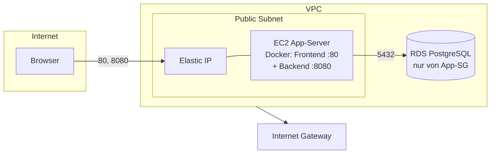

# Shorty – Terraform-Infrastruktur

Mit diesem Ordner wird die komplette Shorty-Stack (PostgreSQL + .NET-Backend + Angular-Frontend) über Terraform aufgesetzt – in zwei Varianten:

| Variante | Ordner | Was wird gebaut | Zielgruppe |
|---|---|---|---|
| **Local** | `local/` | 3 Docker-Container (DB, Backend, Frontend) auf der lokalen Docker-Daemon | Entwicklung am eigenen Rechner |
| **AWS** | `aws/` | VPC + EC2-Instanz (läuft beide Apps in Docker) + RDS PostgreSQL | Deployment in die Cloud |

Beide Varianten teilen sich dieselben Defaults (DB `shorty`/`shorty`, TTLs 24 h / max. 720 h, Cleanup alle 15 min) und sind über `variables.tf` vollständig konfigurierbar.

## Voraussetzungen

- [Terraform](https://developer.hashicorp.com/terraform/install) ≥ 1.5 (getestet mit 1.17)
- **local:** eine laufende Docker-Daemon (Linux: normal; Windows/macOS: Docker Desktop)
- **aws:** konfigurierte AWS-Credentials (`aws configure` oder Umgebungsvariablen) und ein Account mit Zugriff auf EC2/RDS

### Erlaubte Hosts fürs Frontend (Angular SSR)

Angular 22 prüft aus Sicherheitsgründen (SSRF-Schutz) den `Host`-Header jeder Anfrage gegen eine Whitelist – ohne Konfiguration antwortet der SSR-Server mit `400 Bad Request`. Die erlaubten Hosts werden über die Umgebungsvariable `NG_ALLOWED_HOSTS` am Frontend-Container gesetzt:

- **local:** Variable `frontend_allowed_hosts` (Default `localhost,127.0.0.1`)
- **aws:** Variable `frontend_allowed_hosts` plus die Elastic IP der Instanz (wird automatisch ergänzt)

Der Port im `Host`-Header (z. B. `localhost:4200`) ist dabei egal – geprüft wird nur der Hostname. Wer z. B. auch über einen Domain-Namen zugreifen will, trägt den einfach in `frontend_allowed_hosts` ein.

---

## Variante 1: Local (Docker)

Setzt exakt denselben Stack auf wie `docker compose up` aus dem Repo-Root – Container-Namen, Ports und Volume werden wiederverwendet, es ist also ein Drop-in-Ersatz.

### ⚠️ Vorher: bestehende Compose-Stack stoppen

Die Terraform-Ressourcen nutzen dieselben Namen und Ports (`shorty-db`, 5432/8080/4200). Solange der Compose-Stack läuft, kollidiert `terraform apply`:

```bash
cd ..            # Repo-Root
docker compose down
```

### Anwendung

```bash
cd terraform/local
cp terraform.tfvars.example terraform.tfvars   # optional – alles hat Defaults
terraform init
terraform apply
```

**Windows / Docker Desktop:** Der Docker-Provider braucht den Daemon-Pfad. Einmalig in `terraform.tfvars` setzen:

```hcl
docker_host = "npipe:////./pipe/docker_engine"
```

Auf Linux/macOS kann `docker_host` leer bleiben.

### Ergebnis

`terraform output` zeigt unter anderem:

| Output | Default |
|---|---|
| `frontend_url` | http://localhost:4200 |
| `backend_api_url` | http://localhost:8080 |
| `swagger_ui_url` | http://localhost:8080/swagger |

Die Images beider Apps werden direkt aus dem Repo gebaut (`../../shorty_backend`, `../../shorty_frontend`). Das Image-Tag ist über `backend_image_tag` bzw. `frontend_image_tag` wählbar (Default `latest`) – so lassen sich z. B. Versions-Stände wie `shorty-backend:1.0` ablegen. Ein geänderter Tag legt ein neues Image an; der alte Tag bleibt dank `keep_locally = true` lokal erhalten. Bei Code-Änderungen neu bauen mit:

```bash
terraform apply -replace=docker_image.backend   # bzw. ...frontend
```

(oder einfach `docker build` neu ausführen – `keep_locally = true` hält das Image im Cache.)

### Datenbestand & Aufräumen

- Die DB-Daten liegen im Named Volume `shorty-db-data` und **überleben `terraform destroy`**. Für einen sauberen Zustand:

  ```bash
  docker volume rm shorty-db-data
  ```

- Kompletter Rückbau: `terraform destroy`

### Wichtige Variablen (Auswahl)

| Variable | Default | Beschreibung |
|---|---|---|
| `project_name` | `shorty` | Prefix für Netzwerk, Container, Volume |
| `backend_image_tag` / `frontend_image_tag` | `latest` | Tag der gebildeten App-Images (z. B. eine Versionsnummer) |
| `db_password` | `shorty` | PostgreSQL-Passwort (sensitive) |
| `db_host_port` / `backend_host_port` / `frontend_host_port` | 5432 / 8080 / 4200 | Host-Ports |
| `default_ttl_hours` / `max_ttl_hours` | 24 / 720 | Standard-/Max-TTL für gekürzte Links |
| `cleanup_interval_minutes` | 15 | Intervall des Ablauf-Cleanups im Backend |
| `frontend_allowed_hosts` | `localhost,127.0.0.1` | Hostnamen, die das Frontend (SSR) annimmt – siehe oben |

---

## Variante 2: AWS

Baucht eine eigene VPC mit Public Subnet (Single-AZ, bewusst simpel gehalten), eine EC2-Instanz (Amazon Linux 2023, `t3.small`) und eine RDS-PostgreSQL-Instanz (`db.t4g.micro`). Die EC2-Instanz klonnt das Repository beim Booten, baut beide Docker-Images und startet sie – inklusive Warten, bis die RDS erreichbar ist.

> 💰 **Kosten-Hinweis:** Mit `terraform apply` entstehen ab sofort laufende Kosten (EC2 + RDS + Storage + EIP). Für ein Kursprojekt grob im Bereich von wenigen Dutzend Euro pro Monat. Nach der Prüfung/dem Demo-Zeitraum unbedingt `terraform destroy` ausführen.

### ⚠️ Sicherheit vor dem Apply

- `allowed_cidr_blocks` steht standardmäßig auf `["0.0.0.0/0"]` (Frontend + API öffentlich). Im produktiven Kontext auf die eigene IP eingrenzen, z. B. `["1.2.3.4/32"]`.
- Das Deploy-Log auf der Instanz enthält durch `set -x` Passwörter im Klartext – nicht veröffentlichen.

### Anwendung

```bash
cd terraform/aws
cp terraform.tfvars.example terraform.tfvars
# tfvars anpassen: region, key_pair_name, repo_url, repo_token, db_password
terraform init
terraform plan
terraform apply
```

Das dauert ca. 10–15 Minuten (RDS-Provisionierung ist der langste Schritt). Danach:

| Output | Wert |
|---|---|
| `frontend_url` | `http://<öffentliche-IP>` |
| `backend_api_url` | `http://<öffentliche-IP>:8080` |
| `swagger_ui_url` | `http://<öffentliche-IP>:8080/swagger` |

### Neue Version deployen

Der User-Data-Script läuft nur beim (Re)Boot der Instanz. Nach einem Push neuer Commits:

```bash
aws ec2 reboot-instances --instance-ids <i-xxxx>
```

Alternativ die Instanz ersetzen: `terraform apply -replace=aws_instance.app`.

> Hinweis: `user_data_replace_on_change = false` ist gesetzt, damit geänderte TF-Variablen (z. B. TTLs) die Instanz nicht stillschweigend neu aufbauen – Redeploys laufen bewusst manuell über den Reboot.

### Debugging auf der Instanz

Mit gesetztem `key_pair_name`:

```bash
ssh -i mein-schlüssel.pem ec2-user@<öffentliche-IP>
sudo tail -f /var/log/shorty-deploy.log     # kompletter Deploy-Ablauf
sudo docker ps                               # laufende Container
sudo docker logs shorty-backend              # bzw. shorty-frontend
```

### Wichtige Variablen (Auswahl)

| Variable | Default | Beschreibung |
|---|---|---|
| `region` | `eu-central-1` | AWS-Region |
| `environment` | `dev` | Suffix für alle Ressourcen-Namen |
| `instance_type` | `t3.small` | EC2-Größe |
| `key_pair_name` | `""` | SSH-Schlüssel (leer = kein SSH-Zugang) |
| `repo_url` | `https://github.com/itsHyrican/shorty_cloudcomputing.git` | zu clonendes Repository |
| `repo_branch` | `main` | Branch zum Klonnen |
| `repo_token` | `""` | GitHub-Token, **nur bei privatem Repo** (sensitive) |
| `db_instance_class` | `db.t4g.micro` | RDS-Größe |
| `allowed_cidr_blocks` | `["0.0.0.0/0"]` | Quellen für HTTP/API-Ingress |
| `frontend_allowed_hosts` | `localhost,127.0.0.1` | zusätzliche erlaubte Hostnamen; die Elastic IP kommt automatisch dazu |
| TTL-Variablen | 24 / 720 / 15 | wie bei der lokalen Variante |

### Rückbau

```bash
terraform destroy
```

Die RDS wird mit `skip_final_snapshot = true` final gelöscht (Default). Falls Snapshots gewünscht sind, `skip_final_snapshot = false` setzen und bei `destroy` einen Snapshot-Namen angeben.

---

## Struktur

```
Terraform lädt alle `*.tf` eines Ordners zusammen – die Aufteilung in mehrere Dateien ist rein organisatorisch und gliedert nach Baustein.

```
terraform/
├── README.md
├── .gitignore                  # ignoriert State, .terraform/, tfvars (außer *.example)
├── local/
│   ├── provider.tf             # Terraform-Konfiguration + Docker-Provider
│   ├── network.tf              # Docker-Netzwerk
│   ├── database.tf             # PostgreSQL-Container
│   ├── backend.tf              # Backend-Image + Container
│   ├── frontend.tf             # Frontend-Image + Container
│   ├── variables.tf
│   ├── outputs.tf
│   └── terraform.tfvars.example
└── aws/
    ├── provider.tf             # Terraform-Konfiguration + AWS-Provider
    ├── network.tf              # VPC, Subnet, Internet-Gateway
    ├── security.tf             # Security Groups (Web + RDS)
    ├── database.tf             # RDS PostgreSQL
    ├── app_server.tf           # EC2-Instanz + Elastic IP
    ├── variables.tf
    ├── outputs.tf
    ├── user_data.sh.tpl        # Deploy-Skript der EC2-Instanz
    └── terraform.tfvars.example
```
```

## Architektur (AWS)


